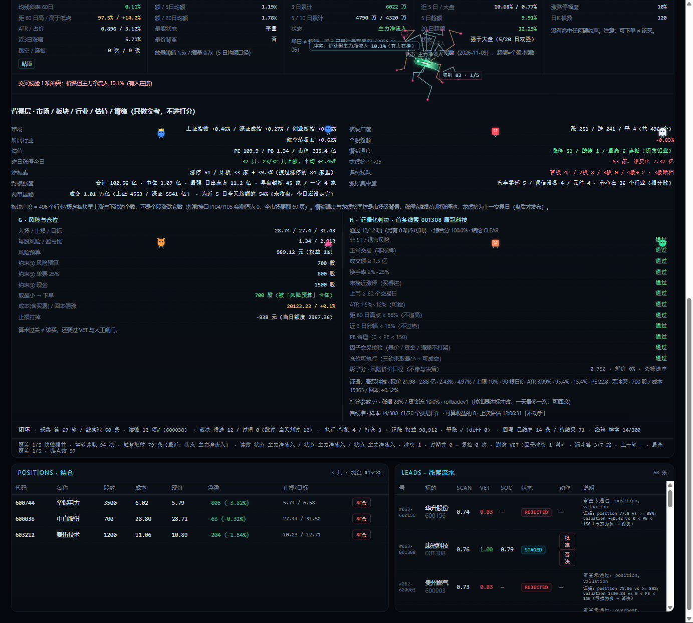
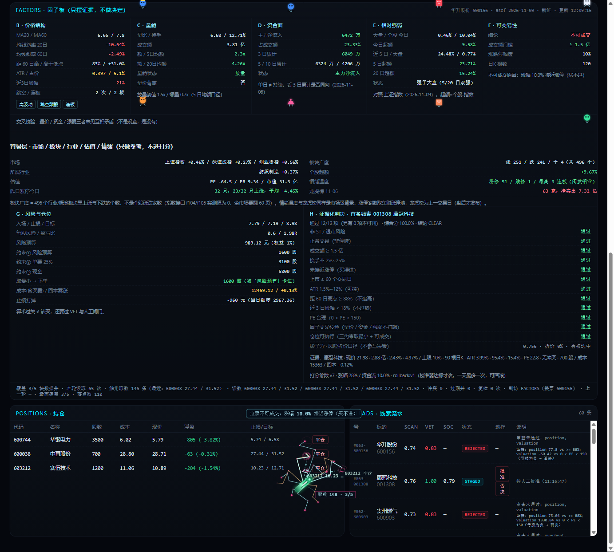
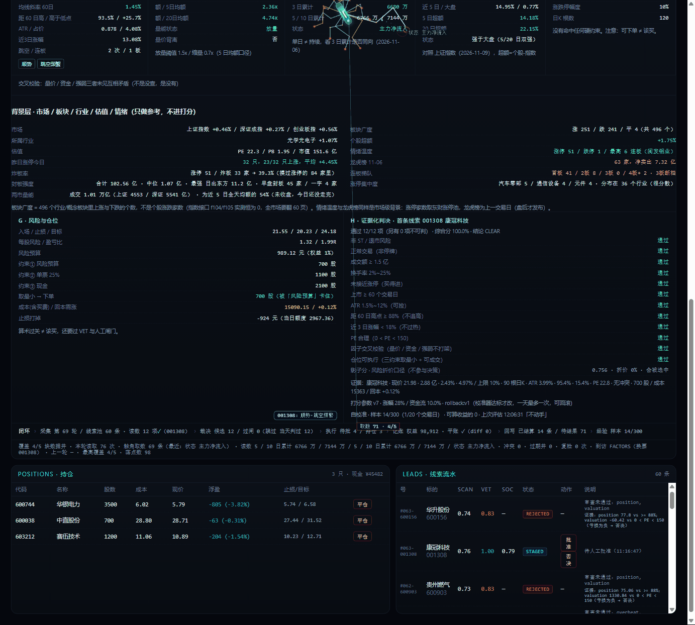
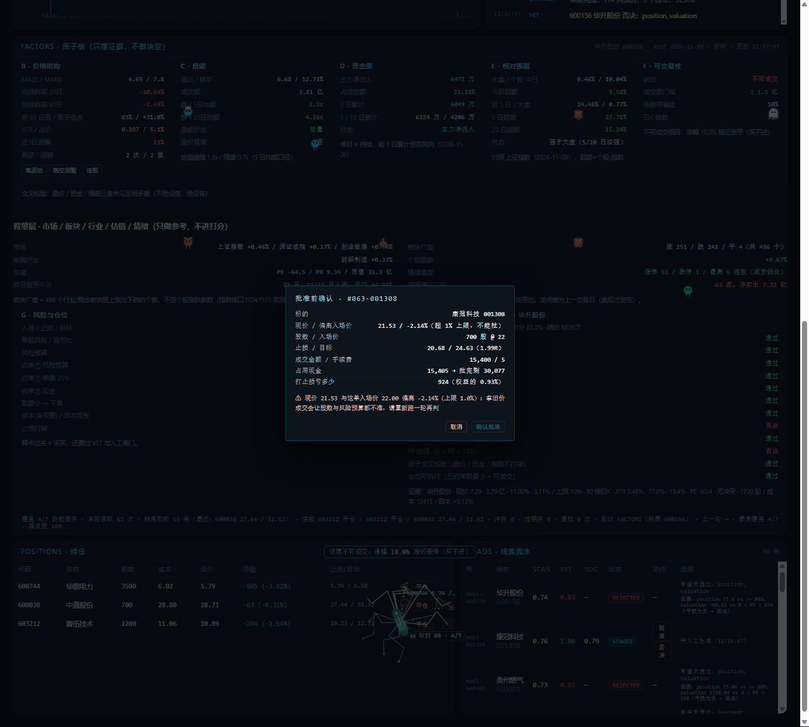
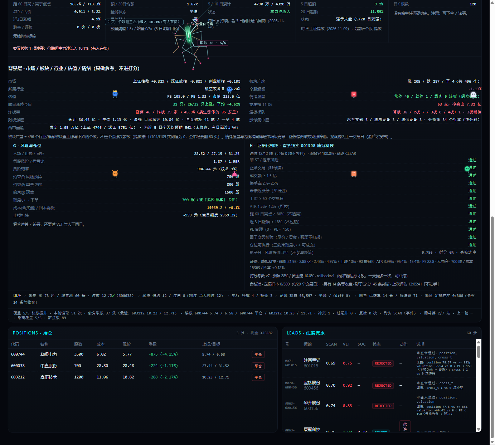
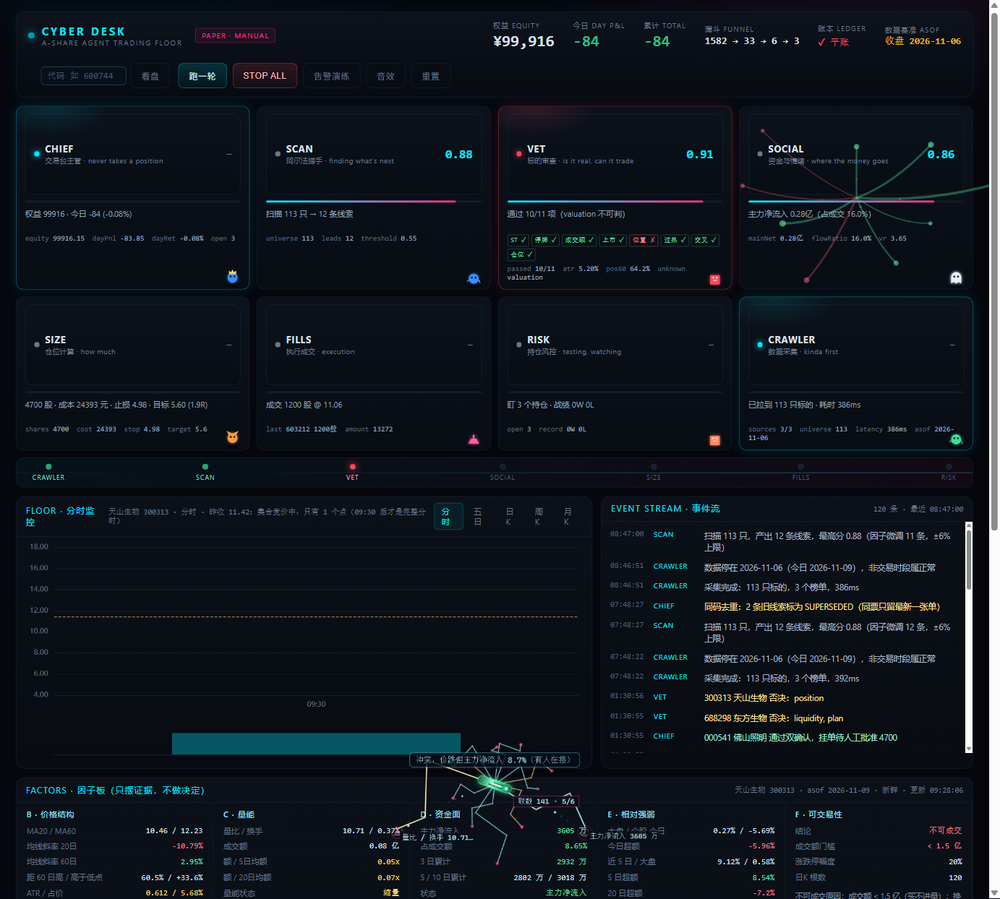
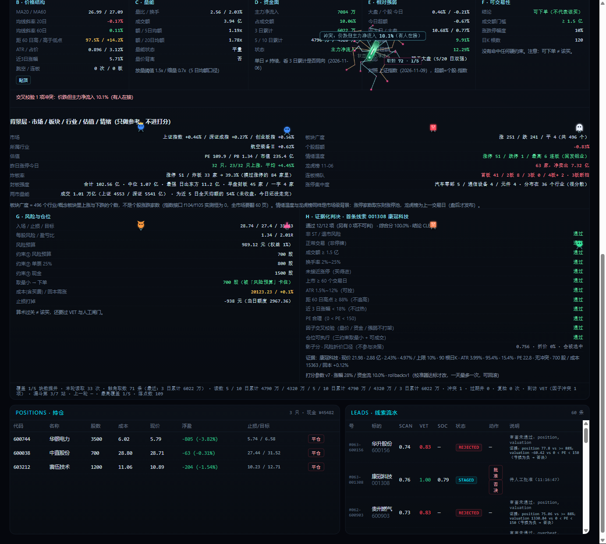

# 赛博交易室 · Cyber Trading Desk

把「人盯着屏幕上的数字拍板」这件事，做成一条**每一步都能被验证**的链路：

```
采集 → 裁决 → 人工审批 → 记账 → 结果回写 → 参数自校准
```

> **状态：PAPER · MANUAL（模拟盘 + 人工审批）**
> 行情是真的（东方财富公开接口 `push2 / push2his / push2ex / datacenter-web`），下单是纸面的。
> 这不是实盘交易系统，不承诺任何收益，不构成投资建议。

---

## 它到底在解决什么问题

大部分"交易看板"的问题是：页面显示一套数字，后端算另一套，人对不上也不报错，最后是**看着错的东西做决定**。

这个项目把重点放在「让两边不可能悄悄不一致」上：

1. 页面上的因子读数会被**原样回传给后端**，后端重新算一遍逐项比对，对不上就**禁止批准**。
2. 订单里带的是生成那一刻的快照价，批准时的现价会被重新校验，偏离超 1% 就**拒绝**。
3. 每一次判定都落 append-only 审计；事后的收益标签、影子分对照、参数改动全部可回放。

界面本身是个 1383×1244 的单页看板，上面爬着一只"蜘蛛"和几个工位小人 —— 它们不是特效，触角落点是页面上真实的数字节点，读到的值会进入上面第 1 条校验。



---

## 五段闭环与各自的验证方式

| 环节 | 做什么 | 怎么证明它真在跑 |
|---|---|---|
| **采集** | 蜘蛛把触角落到页面的因子行/表格单元格，读文本并回执 | 页面把 12 项读数 POST 回后端，后端重算比对，返回 `n=12 bad=0` |
| **裁决** | 12 项检查 + 9 条硬门槛（ST / 停牌 / 流动性 / 上市天数 / 位置 / 过热 / 因子交叉 / 仓位可执行 / 早盘量能） | 每条判决写审计，含 `failed` / `unknown` / `factor` 快照 |
| **审批** | 人工点批准 —— 系统只给建议，不自己下单 | `PAPER · MANUAL`，`approve` 是唯一出口 |
| **记账** | 权益 / 现金 / 持仓 / 已实现 / 未实现 | 恒等式 `权益 = 现金 + 市值` 每次落盘都校验，`diff=0` 才叫平账 |
| **回写** | 次日开盘价做 entry，算 `r0/r1/r3/r5` 收益标签 | 标签 append-only，盘中样本标记 `day_final=False` 不进结论 |



---

## 四个真正难的地方

### 1. 页面读数与接口数据的一致性闸门

人照着页面上的 `MA20 = 18.65` 做决定，后端算出来却是别的值 —— 这种情况不会报错，只会悄悄错。

做法：把页面的 `.fxrow` 行原样 POST 回后端，后端**重新算一遍 `factors.compute()`**，逐项比对：

- **慢变量**（MA20/MA60、均线斜率、ATR、跳空、K 线根数）：容差 1.5%，不符 → 判 `drift`，**禁止批准**
- **快变量**（近 3 日涨幅、成交额、量比、主力净流入、今日超额）：容差 25%，不符只记 `live_diff`，不拦
- 页面数值先过本地解析：`3.94 亿` / `6472 万` / `x / y` 都要能换回数字，换不出返回 `None` 而**不是 0**

分档的原因很实在：页面是几分钟前渲染的，拿"重算的当前值"去比"几分钟前的渲染"必然有差。把慢变量拦死、快变量只记录，才不会把时间差误判成数据错误。



### 2. 快照价的 fail-closed 守卫

线索里带的是生成那一刻的入场价。批准发生在几分钟后，价格已经动了。

`偏离 = 现价 / 快照价 - 1`，**双向都拦**，阈值 1%。**取不到现价也拒** —— 宁可少做一单，不要拿旧价算股数和风险预算。



### 3. 参数外置 + 可回滚的版本快照

打分权重从代码里拿出来，放 `desk_params.json`，每次改动落一份 `desk_params.d/v{n}.json`。

踩过的坑：初版 `params_rollback` 让版本号倒退，下次 `apply` 复用同一个号，**覆盖了历史快照** —— "能回滚"是假的。改成**版本号只增不减**，回滚是"用旧内容建新版本"。

### 4. 校准器：证据不足时拒绝动手

`calibrate.py` 只做一件事：比较"影子口径（把风险折进分数）"和"线上口径"谁更好，好到超过噪音才动，一次只动两项、各 0.05。

门槛写死：`≥20 个影子样本`、`两组各 ≥5`、`≥20 个交易日`、`差异 ≥0.5 个百分点`。**样本不够就拒绝**，并把拒绝理由连分母一起打印出来：

```
定稿影子样本 n=0 < 20（另有 14 条等收盘定稿）
影子分标签只覆盖 2/145 条判断
只覆盖 0 个交易日 < 20
```

"20 个交易日"这条绕不过去，也不打算绕：一天判 40 只票能凑出 40 个样本，但它们不是 40 个独立证据。

---

## 自进化（RSI）做到哪一步了

这里必须说实话，因为它比"我们能自我进化"这种说法有用得多。

**Recursive Self-Improvement = 系统用自己产生的经验去改进下一代自己。**

已经通的：判定 → 审计落库 → 收益标签回填 → 影子分对照 → 评估 → 有界改参数 → 版本快照 → 一键回滚。每一环都有代码、有审计、有 API、有界面显示。

**还没通的**：它**一次都没真正改过参数**。当前参数 `v7` 的来源是 `rollback:v1`（人为回滚），不是校准器改的。

原因不是代码不行，是证据不够：

- 影子分从 2026-11-09 11:52 才开始每条判断都记（此前 145 条判断写在功能上线之前，缺 ATR/pos60，**补不回来**）
- 定稿样本盘中是 0，收盘后 14 条，仍 < 20
- 交易日覆盖 1 天，仍 < 20

所以界面上会同时看到两个数：

```
经验 定稿样本 0/300（另有 14 条等收盘）
自校准 · 定稿样本 0/300（0/20 个交易日）· 影子分 2/145 条判断 ·「不动手」
```

**盘中 `0/300` 是正确的数字，不是坏了。** 盘中 `r0` 是现价不是收盘价，拿它算平均等于拿没打完的比赛算比分。



---

## 采集器形态

蜘蛛的触角不是装饰线。它每次落在一个真实 DOM 节点上（因子行、表格单元格），读文本、带回执，遥测里有 `grabs`（取数次数）、`coverage`（覆盖了几个数据区块）、`grabAge`（距上次取数多久）。



---

## 五个实时轮动板块

除个股因子外，另有 5 块全市场实时结构指标（**只做背景参考，不进门槛、不进打分**）：

| 板块 | 口径 |
|---|---|
| 炸板率 | 炸板家数 /（涨停 + 炸板） |
| 连板梯队 | 首板 / 2 板 / 3 板 / 4 板+，含断档标记 |
| 封板强度 | 封单额合计、中位、最强；一字板与早封家数 |
| 涨停集中度 | 涨停股的行业分布 Top |
| 两市量能 | 当日成交额 / 近 5 日全天均额（盘中标"未收盘"） |

这五块踩过一个**静默失效**：`TopicZBPool` 用 `sort=fund:asc` 会返回 `data.tc=33` 但 `data.pool=[]` —— 只看 `len()` 会得出"今天 0 家炸板"的假结论，而且不报错。修法是按池子选用 `sort=fbt:asc`。



---

## 快速开始

```bash
cd stock-terminal
python server.py
```

打开 <http://127.0.0.1:8765/desk>（交易室）或 <http://127.0.0.1:8765/>（旧版首页）。

依赖：Python 3（标准库即可，无第三方包）；浏览器内核 Canvas 2D。`echarts.min.js` 已随仓库附带。

自检：

```bash
python selftest.py        # 应输出 5/5 通过
python calibrate.py       # 打印当前评估结论（默认不写任何文件）
```

---

## 目录结构

```
quant-desk/
├── README.md
├── docs/screenshots/              # 效果图
├── 赛博蜘蛛_因子看板设计.md        # 主设计文档（80 KB，含每轮迭代的踩坑记录）
├── 赛博机器人_能力详解.md
├── 赛博交易室_机器人能力规格.md
├── 蜘蛛机器人_动效差距清单.md
├── 蜘蛛与小人_逐帧清单与GitHub对照.md
├── 八件套落地清单.md
└── stock-terminal/
    ├── server.py                  # HTTP 服务 + 路由 + 静态资源
    ├── desk.py                    # 核心：状态机、VET、闸门、参数、读数回喂
    ├── datafeed.py                # 东财公开接口封装（行情/资金流/池/情绪/量能）
    ├── factors.py                 # 因子计算与交叉校验
    ├── plan.py                    # 仓位三约束
    ├── labels.py                  # 收益标签回填 + 样本统计
    ├── calibrate.py               # 校准器（L1 自进化）
    ├── backtest.py                # 历史重放
    ├── selftest.py                # 自检
    ├── drill_stage.py             # 演练数据
    ├── desk.html                  # 交易室单页（含 Canvas 蜘蛛/小人动画）
    ├── index.html
    ├── assets/
    └── echarts.min.js
```

---

## 已知不足（没有粉饰的那部分）

- 历史 145 条判定的影子分**永久缺失**，补不回来；影子对照的真实起点是 2026-11-09 11:52
- 校准器**从未真正改过参数**。正向路径只用构造数据验证过 6 个分支
- 校准器缺"改完变差自动退回"的检测，现在只有人一键回滚
- `reject` 没有二次确认、没有撤销窗口（曾因按钮误触真的误否决过一条线索）
- 读数回喂只覆盖因子板的 12 个可映射字段；持仓表/线索表/计划/判决的页面值尚未纳入
- `unknown` 状态（没读过或超过 300 秒过期）不拦截批准，只做标注
- 个股融资余额拿不到单票；事件/公告、筹码微观结构仍标"不可得"
- 行业相对强弱只到行业指数层面，没有风格维度
- 审批没有身份概念（`who="human"` 是写死的）
- 平仓没有同类价格前置断言（价格守卫只挂在批准上）

---

## 数据来源

东方财富公开接口（`push2` / `push2his` / `push2ex` / `datacenter-web`），无鉴权、无付费数据源、不涉及任何账户信息。

## 免责

本项目仅用于工程能力演示与个人研究，**不是实盘交易系统**，不构成任何投资建议。`PAPER · MANUAL` 是设计约束，不是临时配置。

---

## 联系

- 微信：`Feizai0709`
- 邮箱：229703643@qq.com

想交流工程实现、想看更细的落盘数据，或者直接指正上面那份「已知不足」清单，都欢迎找我。
